# Compact Cross-Slot Frequency Selective Surface for the 2.45 GHz ISM Band


A thin, compact, band-pass **frequency selective surface (FSS)** for the 2.45 GHz ISM band. The unit cell is a
**cross-shaped slot loaded with stepped T-bars**, etched in a copper layer on polyimide substrate.
The design was built step by step in **CST Studio Suite 2019**, and its angular and polarisation stability were verified by
parametric sweeps. A lumped **equivalent circuit** was extracted and matched to the simulated S-parameters.

<p align="center">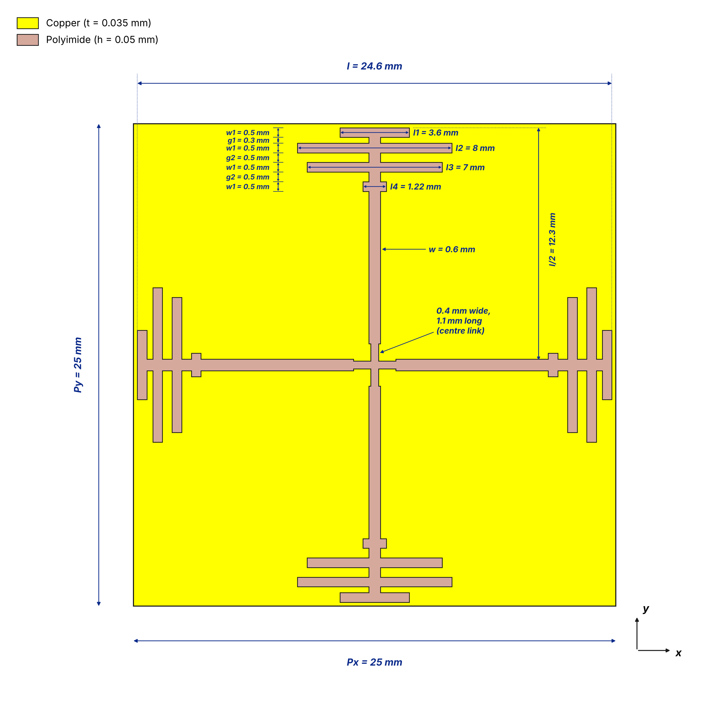</p>

---

## Contents
1. [Key results](#1-key-results)
2. [Design](#2-design)
3. [Design evolution (step by step)](#3-design-evolution-step-by-step)
4. [Simulation setup](#4-simulation-setup-cst-studio-suite-2019)
5. [Results at normal incidence](#5-results-at-normal-incidence)
6. [Why the structure gives this response](#6-why-the-structure-gives-this-response)
7. [Equivalent circuit](#7-equivalent-circuit)
8. [Angular stability (TE and TM)](#8-angular-stability-te-and-tm)
9. [Polarisation stability](#9-polarisation-stability)
10. [How to reproduce](#10-how-to-reproduce)
11. [Future work](#11-future-work)

---

## 1. Key results

| Quantity | Value |
|---|---|
| Centre frequency | **2.45 GHz** |
| \|S11\| at 2.45 GHz | **-27.8 dB** |
| \|S21\| at 2.45 GHz | **-0.36 dB** |
| -3 dB transmission band | 2.17 - 2.76 GHz (**595 MHz**, about 24 % fractional) |
| \|S11\| < -10 dB | 2.34 - 2.56 GHz (217 MHz) |
| Whole ISM band (2.4 - 2.4835 GHz) | \|S21\| better than -0.47 dB, \|S11\| below -16 dB |
| Unit cell | 25 x 25 mm (about 0.2 lambda0 at 2.45 GHz) |
| Thickness | 0.05 mm polyimide + 0.035 mm copper (about 0.085 mm in total) |
| Angular stability | stable for incidence angle theta = 0 - 60 deg (TE and TM) |
| Polarisation stability | stable for phi = 0 - 45 deg at normal incidence |

<p align="center">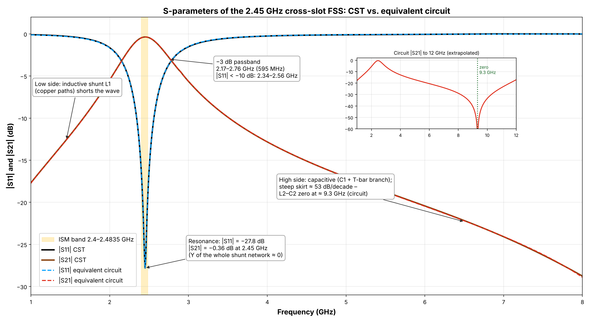</p>

---

## 2. Design

### 2.1 Stack-up (bottom to top)

| Layer | Material | z-range | Thickness |
|---|---|---|---|
| Substrate | Polyimide | 0 to 0.05 mm | h = 0.05 mm |
| Patterned layer | Copper (cross slots etched) | 0.05 to 0.085 mm | mt = 0.035 mm |

In the layout figure, **yellow = copper** and **sandal = polyimide** (the polyimide seen through the slots).
Material data used in CST: polyimide epsilon_r = 3.5, tan delta = 0.0027; copper: annealed copper, 5.8e7 S/m.

### 2.2 Geometry

The unit cell is a four-fold symmetric cross. Each arm is a long slot ending in a **stack of three bars plus a small side bar**; a narrow neck is placed at the centre.

| CST parameter | Value (mm) | Meaning |
|---|---|---|
| `theta`, `phi` | 0, 0 | incidence angles |
| `h` | 0.05 | polyimide thickness |
| `mt` | 0.035 | copper thickness |
| `p` | 25 | periodicity |
| `l` | 24.6 | overall slot length (tip to tip) |
| `w` | 0.6 | stem slot width |
| `l1` | 3.6 | length of the outermost (shortest) bar |
| `w1` | 0.5 | width of every loading bar |
| `l2` | 8 | length of the longest bar |
| `g1` | 0.3 | copper gap between bar l1 and bar l2 |
| `l3` | 7 | length of the third bar |
| `g2` | 0.5 | copper gap between bar l2, bar l3 and the l4 bar |
| `l4` | 1.22 | length of the small bar next to the stem |
| `c` | 1 | length of the narrow neck at the centre (the neck is 0.4 mm wide: 0.1 mm removed from each side of the 0.6 mm stem) |

<p align="center">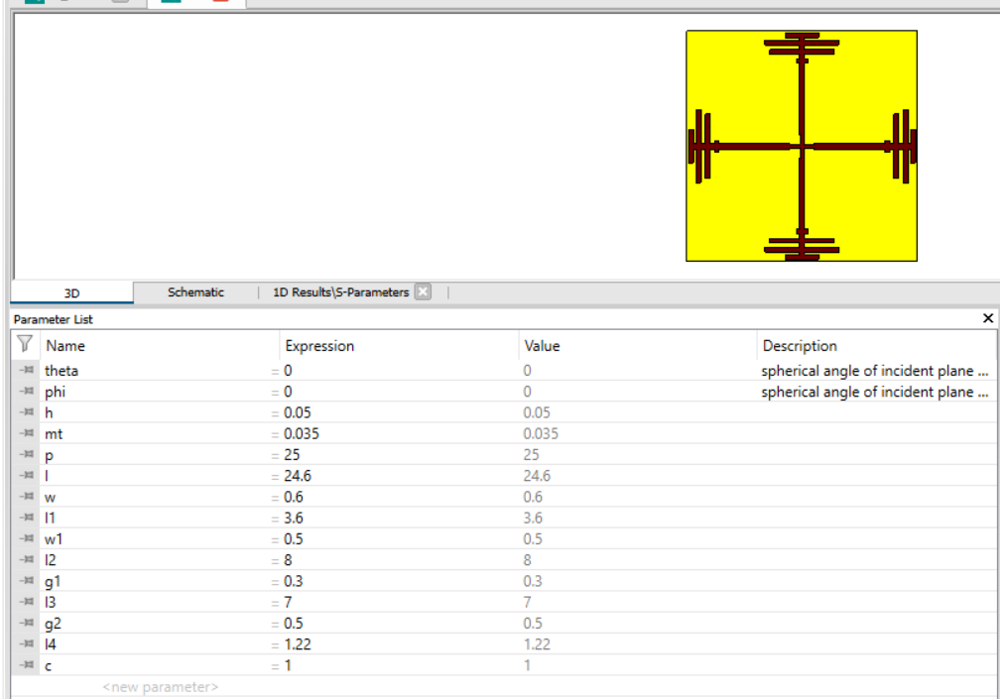</p>

---

## 3. Design evolution (step by step)

The final geometry was reached in six steps. Each step adds one feature and lowers or tunes the resonance. The plots are the CST results of each step; resonance values are read from the plots.

| Step | What is added | Parameters | Resulting resonance (approx.) |
|---|---|---|---|
| 0 | Reference: plain cross slot with a short arm (L = 15 mm) | L = 15, w = 0.6 | about 8.9 GHz |
| 1 | Plain cross slot with full-length arms | l = 24.6, w = 0.6 | about 4.6 GHz (double dip near 4.6 and 4.9 GHz) |
| 2 | End bars on every arm | + l1 = 3.6, w1 = 0.5 | about 4.0 GHz |
| 3 | Second (longest) bar | + l2 = 8, g1 = 0.3 | about 2.8 GHz |
| 4 | Third bar | + l3 = 7, g2 = 0.5 | about 2.34 GHz |
| 5 | Small bar next to the stem | + l4 = 1.22 | about 2.60 GHz, S11 = -29 dB |
| 6 | Narrow neck at the centre (final tuning) | + c = 1, 0.1 mm cut on each side | **2.449 GHz, S11 = -27.8 dB** |

### Step 0 - plain cross slot (reference)
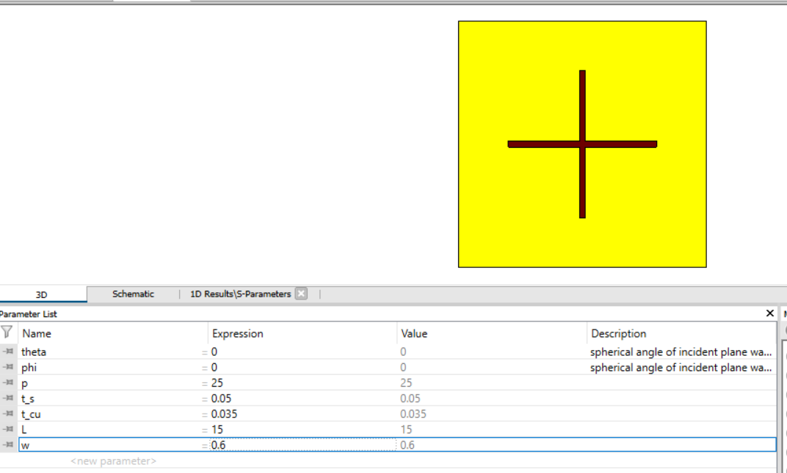
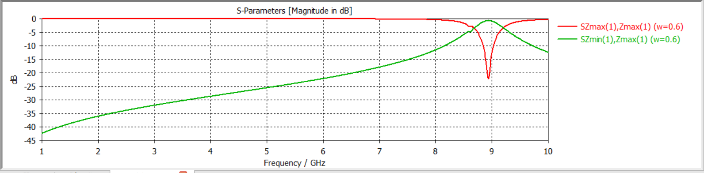

### Step 1 - full-length cross slot
| Structure | S-parameters |
|---|---|
| 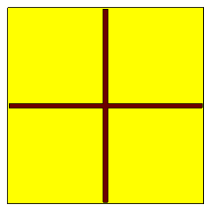 | 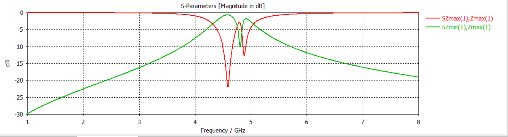 |

### Step 2 - add end bars (l1, w1)
| Structure | S-parameters |
|---|---|
| 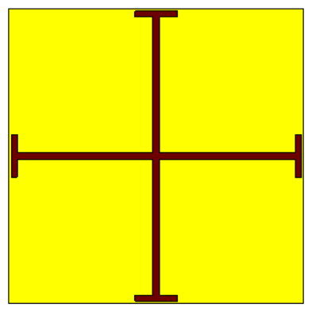 | 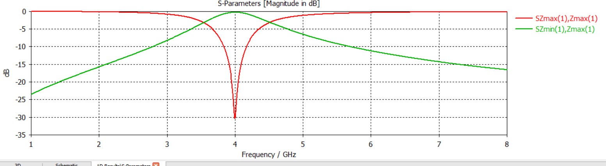 |

### Step 3 - add the long bar (l2, g1)
| Structure | S-parameters |
|---|---|
| 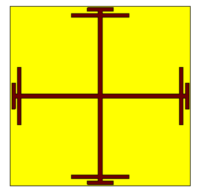 | 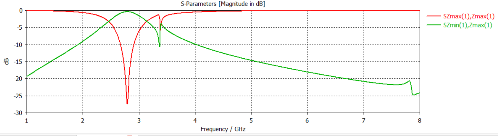 |

### Step 4 - add the third bar (l3, g2)
| Structure | S-parameters |
|---|---|
| 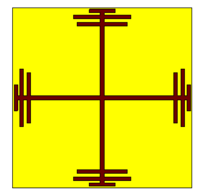 | 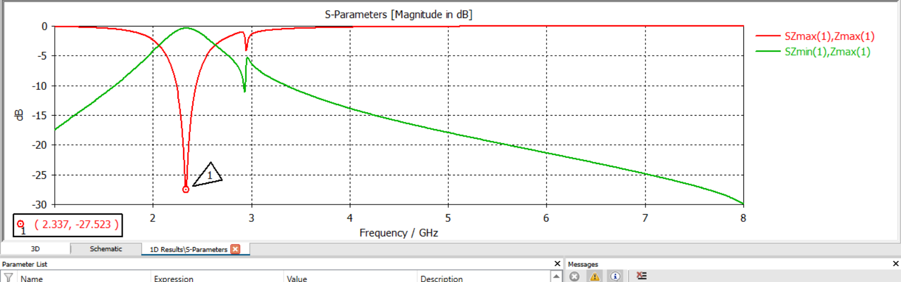 |

### Step 5 - add the small bar (l4)
| Structure | S-parameters |
|---|---|
| 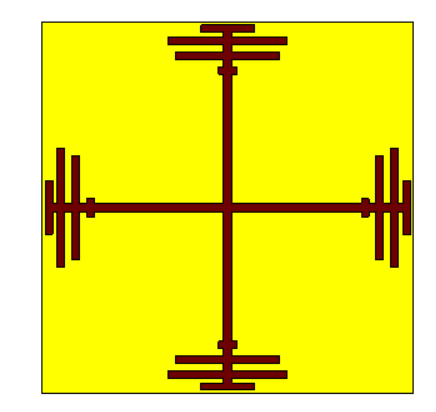 | 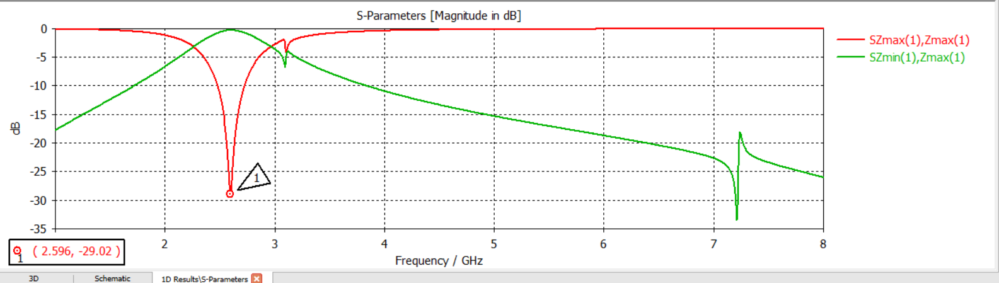 |

### Step 6 - centre neck (c, final design)
| Structure | S-parameters |
|---|---|
| 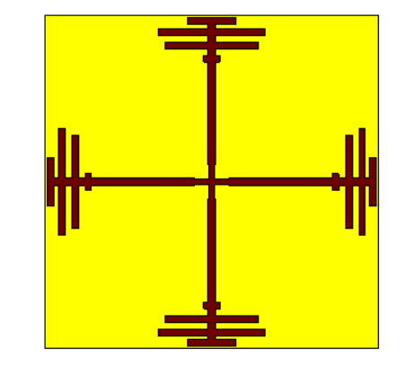 | 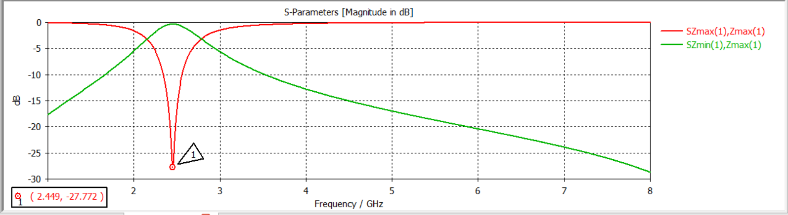 |

**Take-away:** adding bars to the slot ends makes the slot electrically longer and adds capacitance across the thin copper fingers (g1, g2). The resonance falls from about 4.6 GHz to the ISM band while the cell stays 25 x 25 mm. The centre neck is the final fine adjustment that places the null exactly at 2.45 GHz and removes the small extra notch near 3 GHz.

---

## 4. Simulation setup (CST Studio Suite 2019)

| Item | Setting |
|---|---|
| Tool | CST Studio Suite 2019 |
| Model | single unit cell, periodic in x and y |
| Excitation | Floquet ports (Zmin / Zmax) at normal and oblique incidence  |
| Frequency range | 1 - 8 GHz |
| Results | `S(Zmax(1),Zmax(1))` = \|S11\|, `S(Zmin(1),Zmax(1))` = \|S21\| |
| Parametric sweeps | theta = 0 - 90 deg for TE (phi = 0) and TM (phi = 90 deg); phi = 0 - 90 deg at theta = 0 |

The CST project (`.cst`) is not stored in this repository because of its size.
---

## 5. Results at normal incidence

<p align="center">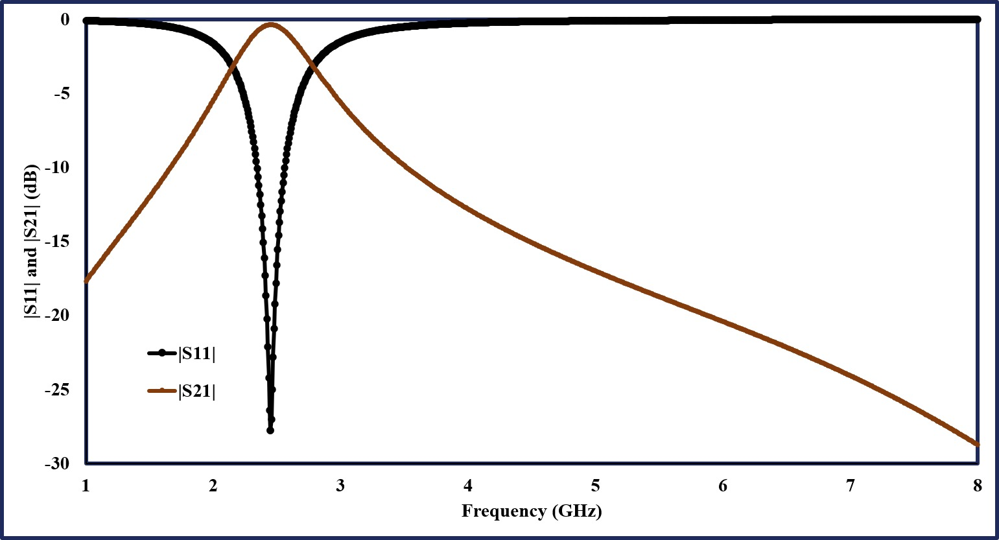</p>

Raw data: [`data/normal_incidence_sparams.csv`](data/normal_incidence_sparams.csv) (frequency in GHz, S11 and S21 in dB, 1 - 8 GHz).

| Metric | Value |
|---|---|
| Resonance | 2.45 GHz |
| \|S11\| minimum | -27.8 dB |
| \|S21\| maximum | -0.36 dB |
| -3 dB band (S21) | 2.169 - 2.764 GHz |
| -1 dB band (S21) | 2.330 - 2.582 GHz |
| \|S11\| < -10 dB | 2.344 - 2.561 GHz |
| \|S11\| < -15 dB | 2.393 - 2.505 GHz |
| \|S21\| at 1 GHz / 8 GHz | -17.7 dB / -28.8 dB |

The sum \|S11\|^2 + \|S21\|^2 is about 0.92 at resonance, so roughly 8 % of the power is absorbed in copper and polyimide.

---

## 6. Why the structure gives this response

* **Band-pass behaviour.** The continuous copper sheet reflects the incident wave everywhere except where the slots let it through. At resonance the slot network behaves like an open circuit in the shunt path, so the wave is transmitted (\|S21\| = -0.36 dB) and \|S11\| drops to -27.8 dB.
* **Lower stop-band (below 2.2 GHz).** The copper sheet is inductive (current flows around the slots), which shorts the wave. S21 falls to -17.7 dB at 1 GHz.
* **Upper stop-band (above 2.8 GHz).** The slot edges and the bar-to-bar gaps are capacitive, so transmission falls steeply (about 53 dB per decade). The loading-bar branch also creates a transmission zero near 9.3 GHz (from the circuit fit, outside the simulated range).
* **Miniaturisation.** A plain slot would need a length of roughly half a wavelength (about 55 mm at 2.45 GHz, scaled from the plain cross of step 0). The stepped T-bars lengthen the electrical path and add coupling capacitance, so a 24.6 mm cross resonates at 2.45 GHz.
* **Bandwidth.** The loaded Q is about 4 (2.45 GHz / 595 MHz), which gives the wide 24 % band.
* **Polarisation.** The four-fold symmetric cross treats x- and y-polarised waves alike at normal incidence.
* **Thin substrate.** At 0.05 mm (about lambda/2400) the polyimide adds only a little capacitance, which keeps the response almost independent of incidence angle.

---

## 7. Equivalent circuit

<p align="center">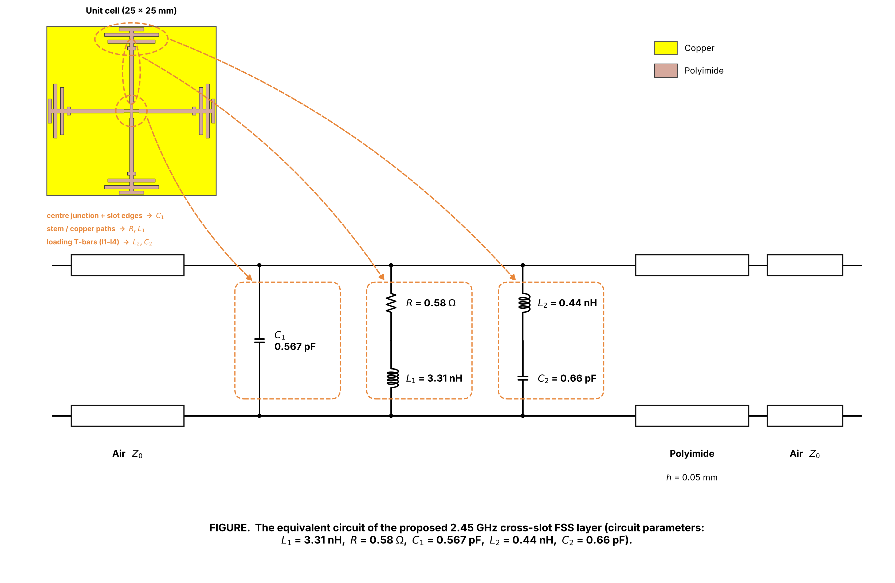</p>

The FSS layer is a shunt network between two free-space lines (Z0 = 377 ohm). The thin polyimide is a very short transmission-line section and is electrically negligible.

| Element | Value | Physical origin |
|---|---|---|
| C1 | 0.567 pF | edge-to-edge capacitance across the slots and the copper fingers (g1, g2) |
| R | 0.58 ohm | copper and polyimide loss |
| L1 | 3.31 nH | inductance of the copper paths around the cross slot |
| L2 | 0.44 nH | inductance of the loading T-bar branch |
| C2 | 0.66 pF | bar-to-bar coupling of the loading T-bars |

Admittance of the shunt network:

```
Y(f) = 1/(R + jwL1) + jwC1 + 1/(jwL2 + 1/(jwC2)),   S21 = 2/(2 + Z0*Y),   S11 = -Z0*Y/(2 + Z0*Y)
```

At 2.45 GHz the inductive susceptance of L1 (about 19.6 mS) is cancelled by C1 (8.7 mS) and the T-bar branch (10.9 mS), so the network is transparent. The series L2-C2 branch resonates at 9.33 GHz.

The element values were **fitted** to the CST data (rms error 0.03 dB for S21 and 0.02 dB for S11 over 1 - 8 GHz), not derived analytically. The assignment of each element to a part of the geometry is a physical interpretation. Run `scripts/fit_equivalent_circuit.py` to reproduce the fit.

---

## 8. Angular stability (TE and TM)

Incidence angle theta was swept from 0 to 90 deg for TE (phi = 0) and TM (phi = 90 deg) polarisation. The response is stable for **theta = 0 - 60 deg**.

**TE, phi = 0**

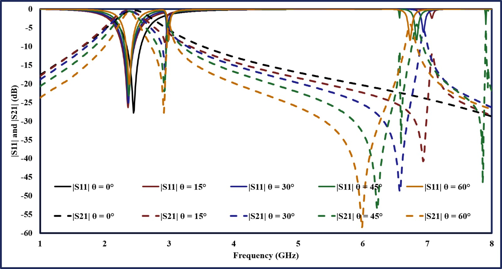


**TM, phi = 90 deg**


Observations from the plot (values read from the curves, approximate):

| Theta | Pass-band minimum of \|S11\| |
|---|---|
| 0 deg | 2.45 GHz, about -28 dB |
| 15 - 45 deg | about 2.37 - 2.40 GHz, about -21 to -26 dB |
| 60 deg | about 2.40 GHz, about -20 dB |

* The pass-band stays near 2.4 GHz with peak transmission close to -0.5 dB; the centre drifts down by only about 2 - 3 % up to 60 deg.
* At oblique incidence a second narrow resonance appears near 2.95 GHz. It lies outside the ISM band.
* The out-of-band transmission zero moves down with angle, from about 6.9 GHz at 15 deg to about 6.0 GHz at 60 deg. It is far above the operating band and does not affect it.
* The cell is only about 0.2 lambda0 in size and the substrate is very thin, so the angular dependence stays weak.

---

## 9. Polarisation stability

The polarisation angle phi was swept from 0 to 90 deg at normal incidence (theta = 0). The response is stable for **phi = 0 - 45 deg**.

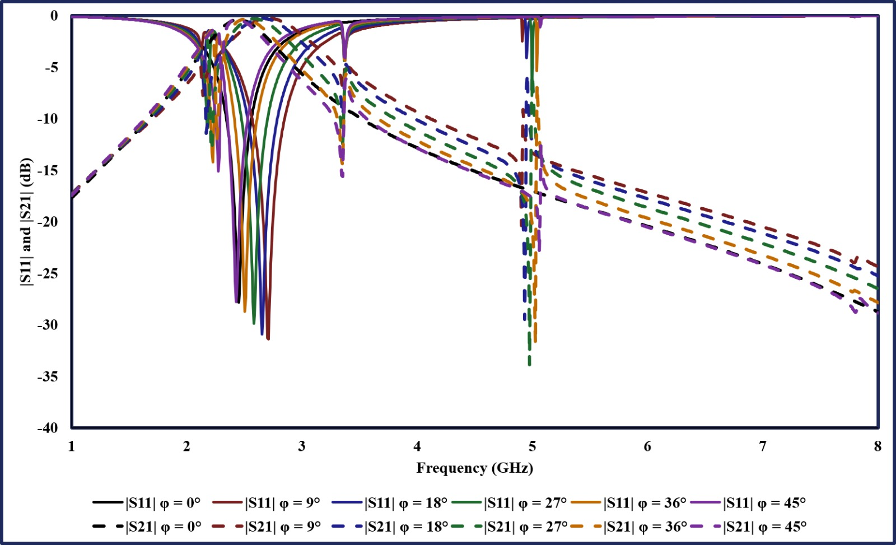

Observations from the plot (approximate):

* The pass-band remains in the 2.4 - 2.7 GHz region for every angle, with the S21 peak close to 0 dB and the same low-frequency and high-frequency skirts for all phi.
* The \|S11\| minimum moves by about 0.25 GHz between phi = 0 and phi = 9 deg and returns toward 2.45 GHz at phi = 45 deg.
* Small extra notches near 3.35 GHz and 5 GHz appear for phi different from 0; they lie outside the ISM band.

---


## 10. How to reproduce

**Python (figures and circuit fit)**
```bash
pip install -r requirements.txt
python scripts/fit_equivalent_circuit.py
python scripts/draw_unit_cell.py
python scripts/draw_equivalent_circuit.py
```

**CST Studio Suite 2019 (simulation)**
1. Create the parameters of section 2.2 in the parameter list.
2. Model the polyimide block from z = 0 to h, and the copper layer from z = h to h + mt.
3. Cut the cross slot with stem width `w` and length `l`. Add the bars in the order of section 3 (`l1`, `l2`, `l3`, `l4`) with width `w1` and gaps `g1`, `g2`.
4. Add the centre neck of length `c` (stem narrowed from 0.6 to 0.4 mm).
5. Apply unit-cell periodic boundaries with Floquet ports and run 1 - 8 GHz.
6. Use the parametric sweep on `theta` (TE: phi = 0, TM: phi = 90 deg) and on `phi` (theta = 0) for the stability studies.

---

## 11. Future work

* Fabrication on flexible polyimide (copper-clad Kapton) and free-space measurement in an anechoic chamber.
* Application as a shield or filter around 2.45 GHz Wi-Fi / Bluetooth devices.
* Bending and conformal-surface analysis for flexible use.
* Add a lossy layer to form a frequency selective rasorber (FSR) with simultaneous transmission and absorption.
* Machine-learning surrogate model of the unit cell (parameters to resonance and bandwidth) for fast optimisation.


---

